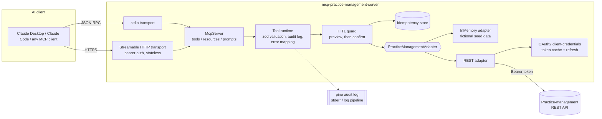

# mcp-practice-management-server

[](https://github.com/Juankia/mcp-practice-management-server/actions/workflows/ci.yml)
[](./LICENSE)
[](./tsconfig.json)
[](https://modelcontextprotocol.io)
[](./package.json)

A production-style **Model Context Protocol (MCP) server** that lets AI agents such as Claude work with a professional-services **practice-management system**: contacts, matters (cases/engagements), tasks, time entries and document metadata. It covers the parts that make an agent integration safe to put in front of a B2B customer. Credentials stay on the server behind an adapter boundary. Every write has a human-in-the-loop preview/confirm step and an idempotency key. Every tool call writes a structured audit line, and errors are mapped to a small set of stable codes. It runs with **zero credentials** out of the box, using an in-memory adapter seeded with fictional data. It also ships a REST adapter skeleton with OAuth 2.0 client-credentials and token caching, ready to point at a real vendor API.

> All names, firms and records in this repository are fictional sample data.

---

## Architecture



The model only sees tool names, input schemas and vendor-neutral JSON results. Tokens, client secrets and upstream error bodies never cross the adapter boundary.

## Tools

| Tool | Kind | Description |
| --- | --- | --- |
| `search_contacts` | read | Search people and companies by name, email or phone fragment. |
| `list_matters` | read | List matters, newest first, filtered by status, client or practice area. |
| `get_matter` | read | Matter plus client, parties, open tasks, time summary and document metadata. Accepts an id (`mt_0001`) or a number (`2026-0001`). |
| `conflict_check` | read | Fuzzy-screens names against every contact and matter party. Adverse parties are ranked first as `high` severity. |
| `create_contact` | write (HITL) | Creates a person or company. The preview lists possible duplicates. |
| `create_matter` | write (HITL) | Opens a matter for an existing client. The preview validates the client. |
| `add_task` | write (HITL) | Adds a task to an open matter. |
| `log_time_entry` | write (HITL) | Logs time in 0.1-hour increments, billable or non-billable. |

**Resources:** `matter://{id}` returns a JSON snapshot of a matter with its tasks, time entries and documents. It supports listing and id completion.
**Prompts:** `new-client-intake` runs the policy workflow (conflict check, then contact, then matter, then first task, with an approval at each write). `matter-status-brief` writes a read-only status summary.

### Human-in-the-loop write protocol

Every write tool takes `confirm` (default `false`) and an optional `idempotencyKey`.

1. **Call without `confirm`.** The server validates the input, for example by checking that the client exists, the matter is open and there is no duplicate contact. It then returns a preview and **writes nothing**:

   ```json
   {
     "status": "preview",
     "summary": "Add task \"Send engagement letter\" to matter 2026-0003 due 2026-10-15",
     "wouldWrite": { "matterId": "mt_0003", "title": "Send engagement letter", "dueDate": "2026-10-15" },
     "idempotencyKey": "auto-4f1c...",
     "nextStep": "Nothing has been saved. Show this preview to the user ..."
   }
   ```

2. **Show the preview to the user.** After the user explicitly approves, call again with `"confirm": true` and the same `idempotencyKey`. The server returns `status: "created"`. A retry with the same key returns `status: "already_created"` and the original record, without writing a second time.

## Quickstart

Requires Node.js 20.19 or later.

```bash
git clone https://github.com/Juankia/mcp-practice-management-server.git
cd mcp-practice-management-server
npm install
npm run build

# Inspect it interactively with the official MCP Inspector
npx @modelcontextprotocol/inspector node dist/index.js
```

Useful scripts:

| Script | What it does |
| --- | --- |
| `npm run dev` | Run from source over stdio (tsx). |
| `npm run dev:http` | Run from source over Streamable HTTP (needs `MCP_HTTP_AUTH_TOKEN`). |
| `npm run check` | Lint, typecheck, test and build, the same steps as CI. |

### Configuration

Copy `.env.example` to `.env` and run `node --env-file=.env dist/index.js`. Configuration is validated with zod at startup, and the process fails fast with a readable message if anything is missing.

| Variable | Default | Notes |
| --- | --- | --- |
| `PM_ADAPTER` | `memory` | `memory` (fictional seed data) or `rest`. |
| `PM_API_BASE_URL`, `PM_OAUTH_TOKEN_URL`, `PM_OAUTH_CLIENT_ID`, `PM_OAUTH_CLIENT_SECRET`, `PM_OAUTH_SCOPE` | none | Required when `PM_ADAPTER=rest`. |
| `MCP_TRANSPORT` | `stdio` | `stdio` or `http`. |
| `MCP_HTTP_HOST` / `MCP_HTTP_PORT` | `127.0.0.1` / `3333` | HTTP transport bind address. |
| `MCP_HTTP_AUTH_TOKEN` | none | Required for `http`, at least 16 characters. Clients send `Authorization: Bearer <token>`. |
| `LOG_LEVEL` | `info` | pino level. |

## Use it from Claude

### Claude Code

```bash
claude mcp add practice-management -- node /absolute/path/to/mcp-practice-management-server/dist/index.js

# or, against the REST adapter (secrets stay in the server's environment)
claude mcp add practice-management \
  -e PM_ADAPTER=rest -e PM_API_BASE_URL=https://api.example.com/v1 \
  -e PM_OAUTH_TOKEN_URL=https://auth.example.com/oauth/token \
  -e PM_OAUTH_CLIENT_ID=... -e PM_OAUTH_CLIENT_SECRET=... \
  -- node /absolute/path/to/mcp-practice-management-server/dist/index.js

# Streamable HTTP
claude mcp add --transport http practice-management http://127.0.0.1:3333/mcp \
  --header "Authorization: Bearer $MCP_HTTP_AUTH_TOKEN"
```

### Claude Desktop (`claude_desktop_config.json`)

```json
{
  "mcpServers": {
    "practice-management": {
      "command": "node",
      "args": ["/absolute/path/to/mcp-practice-management-server/dist/index.js"],
      "env": { "PM_ADAPTER": "memory", "LOG_LEVEL": "info" }
    }
  }
}
```

Then try: *"Run a conflict check for Dana Kesler and Harlow Property Mgmt"*, or pick the **new-client-intake** prompt.

## Design decisions

**Server-side authenticated integration.** Tools depend only on the `PracticeManagementAdapter` interface. The REST adapter gets tokens through OAuth 2.0 client credentials. Tokens are cached in memory, refreshed 60 seconds before expiry, and concurrent callers share one refresh. On a `401` the adapter forces one refresh and retries once. The model never receives a credential and cannot ask for one, because no tool returns one. Upstream response bodies are discarded and mapped to a closed set of error codes (`NOT_FOUND`, `CONFLICT`, `RATE_LIMITED`, `UPSTREAM_UNAVAILABLE`, ...) with a `retryable` flag, so the agent knows whether to retry, ask the user, or stop. The same split lets one deployment serve many users under a single integration identity, with authorization enforced on the server.

**Human-in-the-loop by default.** LLMs act with confidence on partial information. Creating a matter or logging billable time has consequences for clients and invoices, so the default path for every write is a dry run. The preview also does useful validation: duplicate-contact detection, client existence and closed-matter checks. The model therefore has concrete information to show the user before asking for approval. Tool annotations (`readOnlyHint`, `destructiveHint`, `idempotentHint`) let clients apply their own approval UX on top.

**Idempotency keys on creates.** Agents retry. Networks time out after the upstream has already committed. Every create runs through an idempotency store. With the same key and the same payload, the original result is replayed. With the same key and a different payload, the call is rejected with `IDEMPOTENCY_KEY_REUSED`, because that is a caller bug that should be loud. Failed attempts are evicted so they can be retried. If the caller sends no key, one is derived from a canonical hash of the payload. The key is also forwarded upstream as an `Idempotency-Key` header. The store is in-process. For multi-instance deployments, swap it for Redis or a database table behind the same interface.

**Audit log of every tool call.** One structured pino line per call records tool, kind, request id, adapter, outcome (`success` / `preview` / `replayed` / `error`), duration, error code and arguments. PII fields and secrets are redacted. Logs go to **stderr**, because with the stdio transport stdout is reserved for JSON-RPC frames. The request id is also sent upstream as `x-request-id` for end-to-end correlation.

**Conflict checks favour recall.** A missed conflict of interest is a professional-responsibility problem, while a false positive costs a reviewer a few seconds. Names are normalized (accents, punctuation, entity suffixes such as *LLC/Inc*, honorifics), then scored with Jaro-Winkler on both natural and token-sorted order, which handles typos and "Last, First" ordering. Token containment is also scored, so "Bluefin" matches "Bluefin Logistics". Hits on adverse roles rank first. The output always states that a human must review.

**Stateless HTTP.** The Streamable HTTP transport creates a fresh `McpServer` per request and shares the adapter, token cache and idempotency store. It requires a bearer token (compared in constant time), binds to localhost by default, caps request bodies, and exposes `/healthz`.

## Project layout

```
src/
  index.ts              entrypoint: config, transport selection
  server.ts             McpServer factory (tools, resources, prompts)
  config.ts             zod-validated environment
  domain.ts             vendor-neutral domain model
  adapters/             adapter interface, in-memory + seed, REST, OAuth2
  core/                 errors, idempotency, fuzzy matching, conflicts, logger
  tools/                tool registrations, schemas, audited/HITL runtime
  transports/http.ts    Streamable HTTP transport with bearer auth
  resources.ts, prompts.ts
test/                   vitest: unit, adapter, MCP client end-to-end, HTTP
```

## Testing

```bash
npm test          # 57 tests
npm run check     # lint + typecheck + test + build
```

The tests drive the real server through the SDK `Client` over an in-memory transport and over Streamable HTTP. They cover preview vs commit, replay, key reuse, input validation, error mapping and audit output. The REST adapter and token provider are tested against a mocked `fetch`: token caching, single-flight refresh, 401 retry, idempotency headers and status mapping.

## Roadmap

- [ ] Persistent idempotency and audit sinks (Redis / Postgres) for multi-instance deployments
- [ ] Per-user OAuth (authorization code + PKCE) via the MCP authorization spec, alongside the service identity
- [ ] Role-based tool scoping (for example, paralegals cannot open matters)
- [ ] Update/close operations with optimistic concurrency (`If-Match`)
- [ ] Document content retrieval through signed URLs, with RAG over matter documents
- [ ] OpenTelemetry traces across tool call, adapter and upstream
- [ ] Vendor-specific REST mappers behind the same adapter contract

## About the author

Built by **Juan Carlos Amay**, AI Architect and Senior Full Stack Engineer (8+ years in fintech and banking), building Claude Skills, MCP servers, RAG pipelines and agents for enterprise clients. [GitHub](https://github.com/Juankia) · [LinkedIn](https://linkedin.com/in/juancarlosamayizquierdo)

## License

[MIT](./LICENSE) © 2026 Juan Carlos Amay
